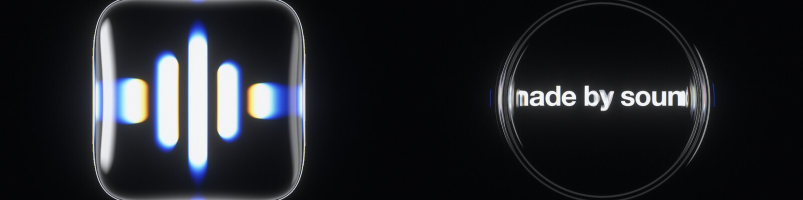
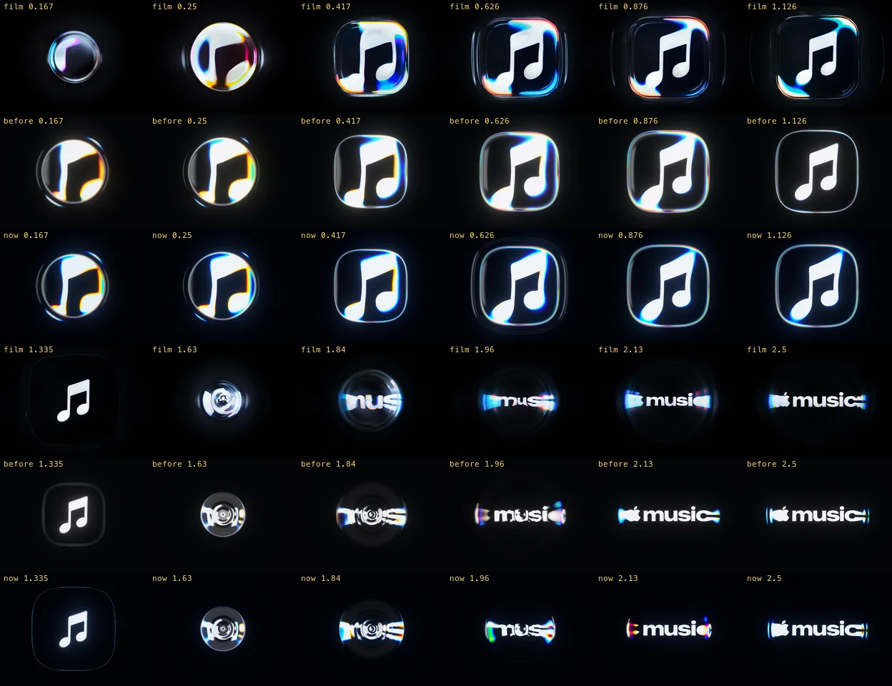

# Made by Sound, Made by Code

> A real-time recreation of the liquid logo animation from Apple Music's new identity: a physically based lens of oil, ray traced in the browser, that works with any logo.

[](explainer.html)

Apple filmed its new mark in a tray of mineral oil, rippled by a two-note sting from Fred again.. and NEST Acoustics. This repo rebuilds the effect on the GPU: a dome of oil that magnifies the logo and smears its ends, animated by a few smooth curves fitted to Apple's film, and spectral ray tracing for the rainbow fringes.

- **Player:** drop in your own icon and wordmark, tune the oil and the light, export an MP4 (1080p or 4K) from the browser.
- **Explainer:** how the original was made, why it looks the way it does, and how to make your own, in code or in a dish of oil (`explainer.html`).
- **Renderer:** deterministic headless renders and a comparison harness against the reference film.

## How it was made

Every change was checked against Apple's film: frame against frame, and as the look's curves over time, so it follows the film's motion rather than matching single frames.




## Getting started

Paste this into a coding agent:

```
Clone https://github.com/transitive-bullshit/apple-music-effect, install it (Node 24+, pnpm,
uv, ffmpeg and Google Chrome), and run `pnpm dev`. Open the player, drop my icon and wordmark
onto it, and export a 1080p MP4. Read contributing.md for the render and comparison commands.
```

## License

The code is [MIT](license) © [Travis Fischer](https://x.com/transitive_bs). This is an unofficial study, not affiliated with Apple. Apple and Apple Music are trademarks of Apple Inc.; the repo ships its own demo brand, and apart from the comparison stills above and the site's share image, Apple's film, music and logos are not included.

---

Want to run it, change it, or see where everything lives? See [contributing.md](contributing.md).
